# 🎓 Full Stack Student Management System

**Devixo Solutions – Web Development Internship | Week 3 – Task 03**
**Author:** Rashid Ahmad ([GitHub](https://github.com/rashid-ahmad199))

A complete Student Management System with authentication, role-based access (Admin / User), a statistics dashboard and permanent database storage.

Built with **Option 2** of the task stack: **React · Node.js · Express · MongoDB**.

---

## ✨ Features

| Module | What it does |
|---|---|
| **Authentication** | Register, Login, Logout using JWT and bcrypt-hashed passwords |
| **Student Module** | Add, Edit, Delete, Search and View Details |
| **Dashboard** | Total students, recent registrations, search bar, statistics cards, students-by-course chart |
| **Database** | All records stored permanently in MongoDB |
| **UI** | Responsive design, professional dashboard, form validation, loading indicators |
| **Bonus** | Pagination and role-based login (Admin / User) |

### Roles
| Action | Admin | User |
|---|:---:|:---:|
| View / search students | ✅ | ✅ |
| Add / edit students | ✅ | ✅ |
| Delete students | ✅ | ❌ |
| See "System Users" card | ✅ | ❌ |

The **first account registered** automatically becomes the Admin. Everyone after that is a normal User.

---

## 🧰 Tech Stack

- **Frontend:** React 18, Vite, React Router, Axios, plain CSS
- **Backend:** Node.js, Express
- **Database:** MongoDB with Mongoose
- **Security:** JWT, bcryptjs, protected routes, role middleware

---

## 📁 Project Structure

```
A-full-stack-Student-Management-System/
├── client/                  # React frontend
│   ├── src/
│   │   ├── api/             # Axios instance
│   │   ├── components/      # Navbar, Loader, Pagination, StudentForm, ProtectedRoute
│   │   ├── context/         # AuthContext
│   │   ├── pages/           # Login, Register, Dashboard, Students, Add/Edit/Details
│   │   ├── App.jsx
│   │   ├── main.jsx
│   │   └── index.css
│   ├── index.html
│   ├── vite.config.js
│   └── package.json
├── server/                  # Express backend
│   ├── config/db.js
│   ├── controllers/
│   ├── middleware/
│   ├── models/
│   ├── routes/
│   ├── seed.js
│   ├── server.js
│   └── package.json
├── screenshots/
├── .gitignore
├── package.json
└── README.md
```

---

## 🚀 Getting Started

### Prerequisites
- Node.js 18 or newer
- MongoDB running locally **or** a free MongoDB Atlas connection string

### 1. Clone and install
```bash
git clone https://github.com/rashid-ahmad199/A-full-stack-Student-Management-System.git
cd A-full-stack-Student-Management-System
npm run install-all
```

### 2. Configure environment
```bash
cd server
cp .env.example .env      # Windows: copy .env.example .env
```
Open `server/.env` and set `MONGO_URI` and a long random `JWT_SECRET`.

### 3. (Optional) Load demo data
```bash
npm run seed
```
Creates 25 sample students and two accounts:
- Admin: `admin@example.com` / `admin123`
- User: `user@example.com` / `user123`

### 4. Run the app
From the project root:
```bash
npm run dev
```
- Frontend: http://localhost:5173
- Backend API: http://localhost:5000

---

## 🔌 API Reference

| Method | Endpoint | Access | Description |
|---|---|---|---|
| POST | `/api/auth/register` | Public | Create account |
| POST | `/api/auth/login` | Public | Login, returns JWT |
| GET | `/api/auth/me` | Logged in | Current user |
| GET | `/api/students?search=&page=&limit=` | Logged in | List with search and pagination |
| GET | `/api/students/stats` | Logged in | Dashboard statistics |
| GET | `/api/students/:id` | Logged in | Student details |
| POST | `/api/students` | Logged in | Add student |
| PUT | `/api/students/:id` | Logged in | Edit student |
| DELETE | `/api/students/:id` | **Admin** | Delete student |

---

## 📸 Screenshots

> Add your screenshots to the `screenshots/` folder with the names below.

### Register
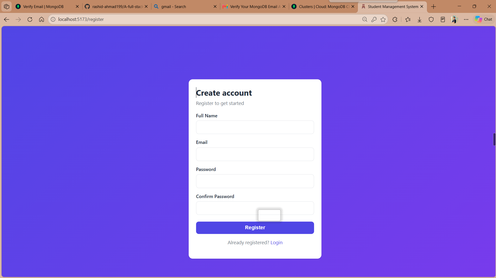
`[INSERT REGISTER SCREENSHOT HERE]`

### Login
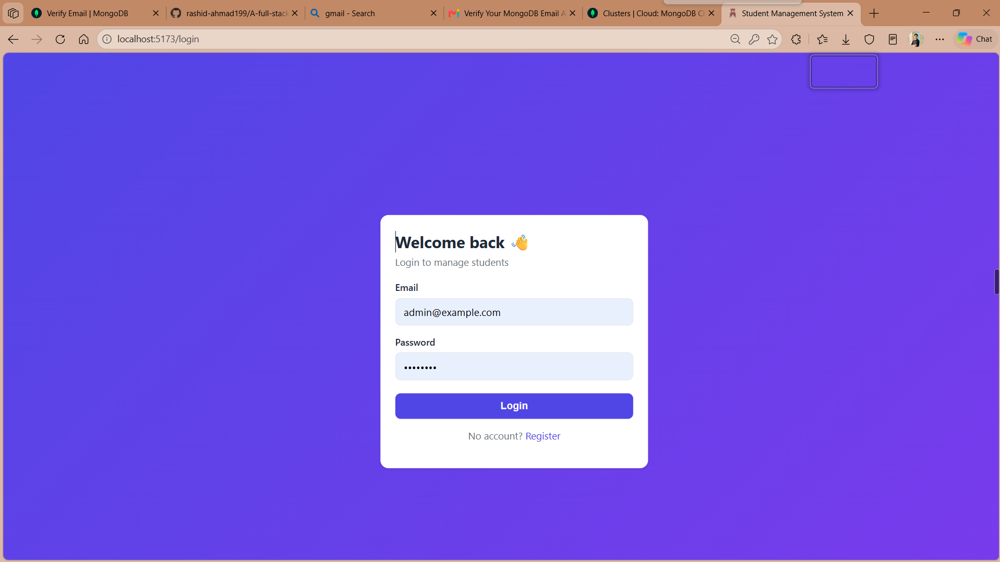
`[INSERT LOGIN SCREENSHOT HERE]`

### Dashboard (Desktop)
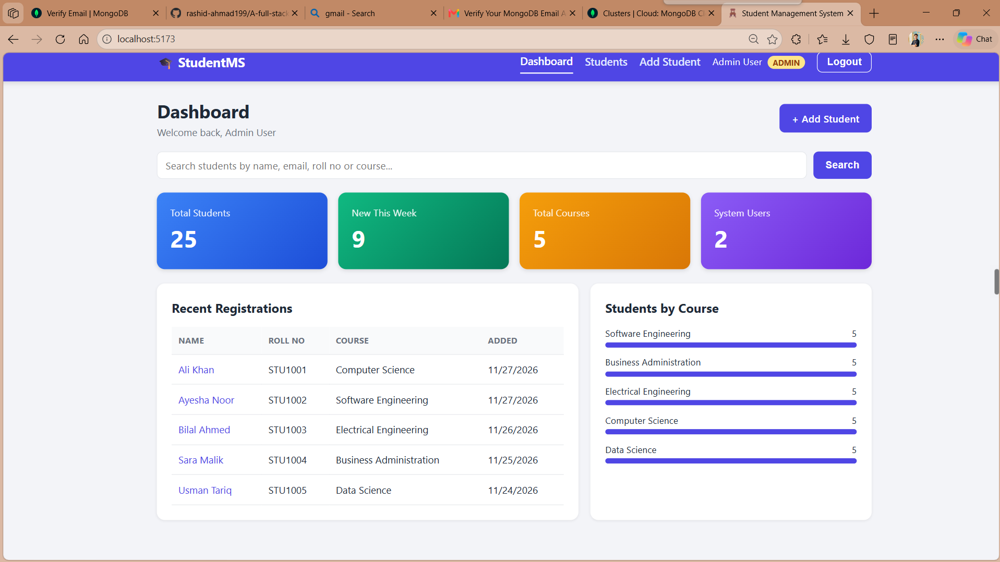
`[INSERT DESKTOP DASHBOARD SCREENSHOT HERE]`

### Students List
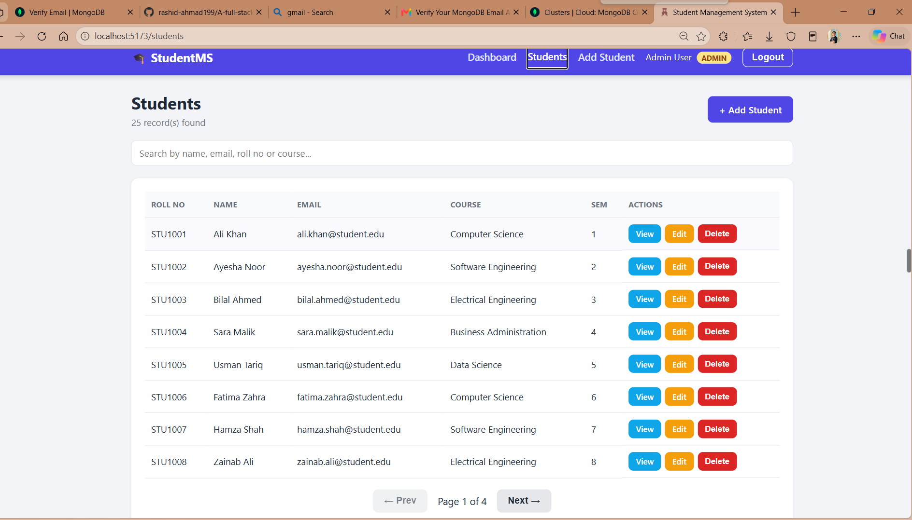
`[INSERT STUDENTS LIST SCREENSHOT HERE]`

### Search
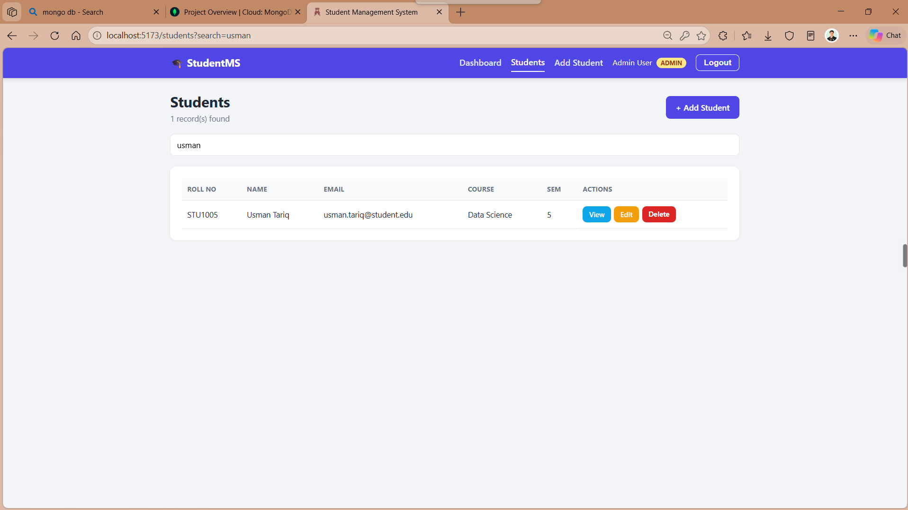
`[INSERT SEARCH RESULTS SCREENSHOT HERE]`

### Add Student and Validation
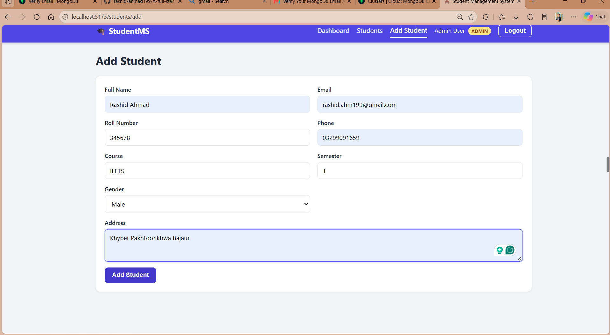
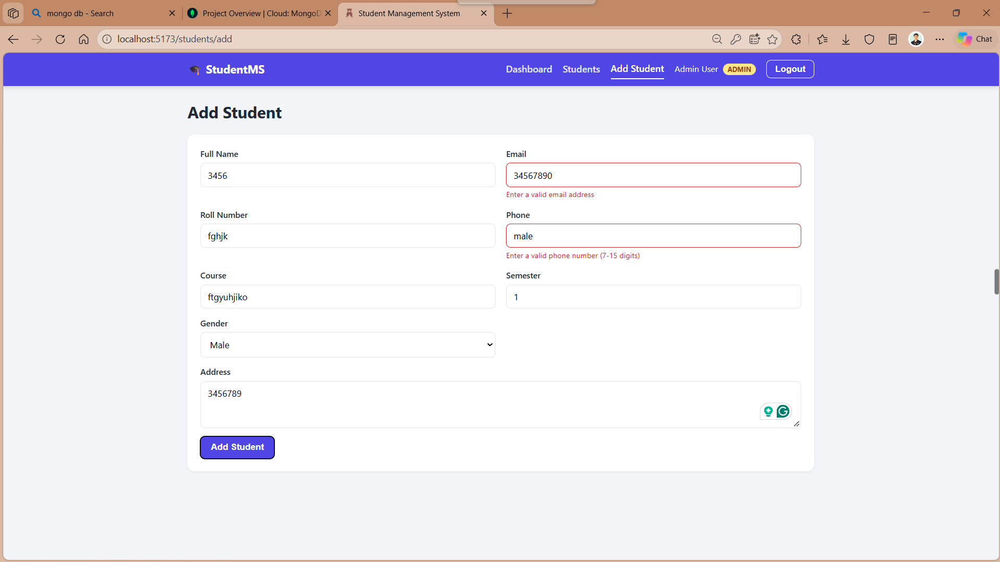
`[INSERT ADD STUDENT + VALIDATION SCREENSHOTS HERE]`

### Edit Student
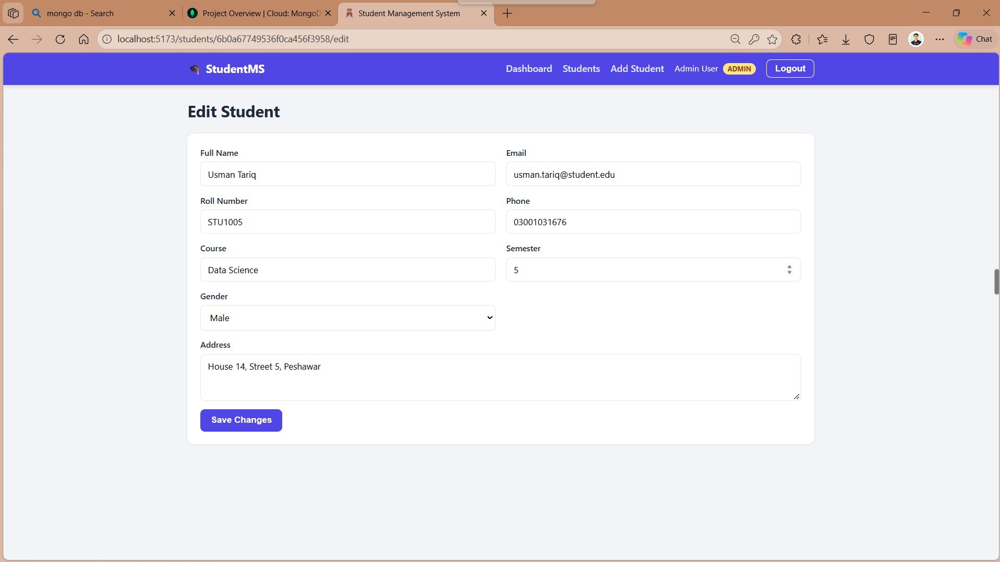
`[INSERT EDIT STUDENT SCREENSHOT HERE]`

### Student Details
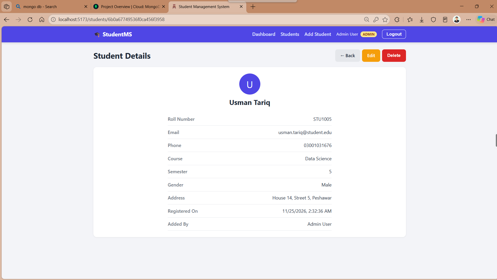
`[INSERT STUDENT DETAILS SCREENSHOT HERE]`

### Delete (Admin)

`[INSERT DELETE CONFIRMATION SCREENSHOT HERE]`

### Pagination

`[INSERT PAGINATION SCREENSHOT HERE]`

### Mobile View
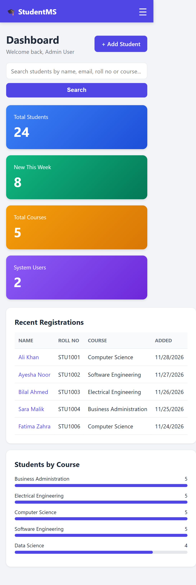
`[INSERT MOBILE SCREENSHOT HERE]`

### Database (MongoDB)
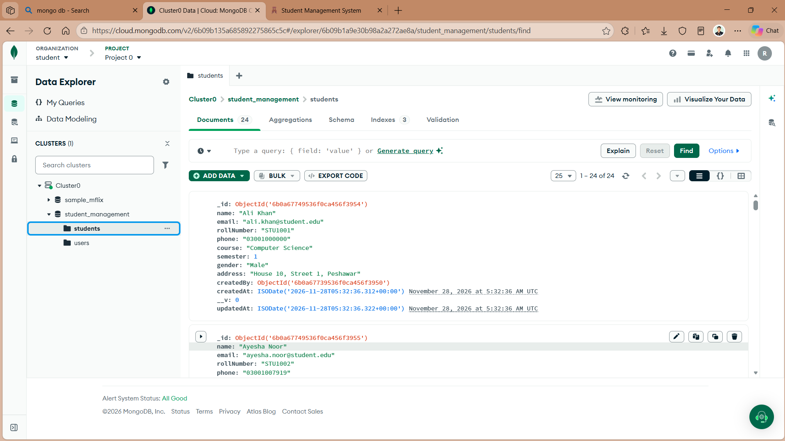
`[INSERT MONGODB DATA SCREENSHOT HERE]`

---

## 👤 Author

**Rashid Ahmad**
GitHub: [@rashid-ahmad199](https://github.com/rashid-ahmad199)
Email: Rashid.ahm199@gmail.com

Developed as part of the Devixo Solutions Summer Internship.
